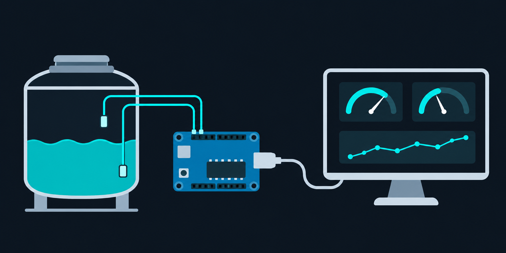
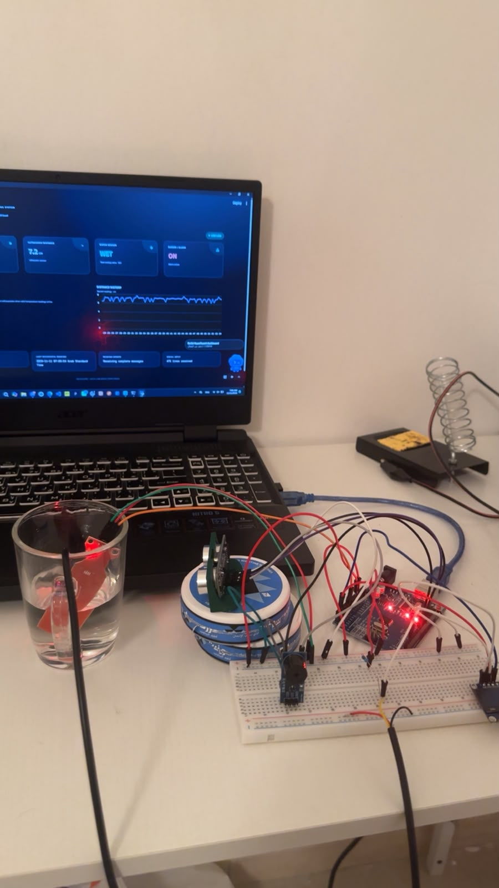
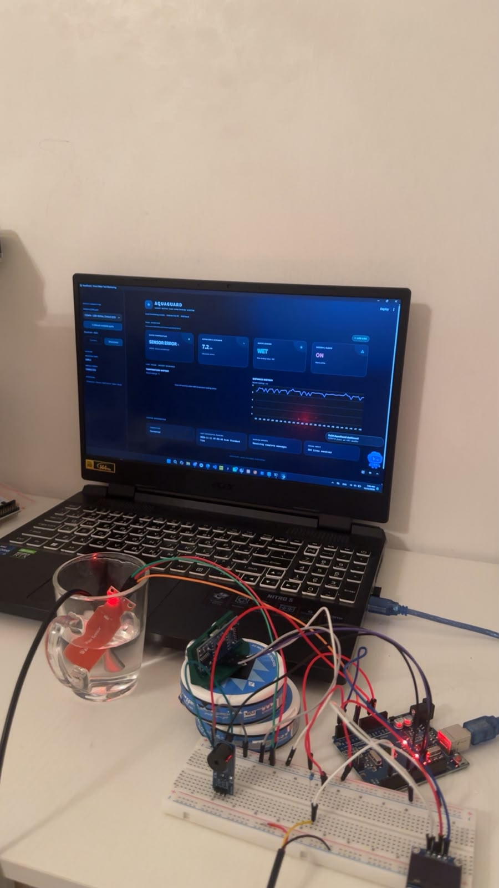
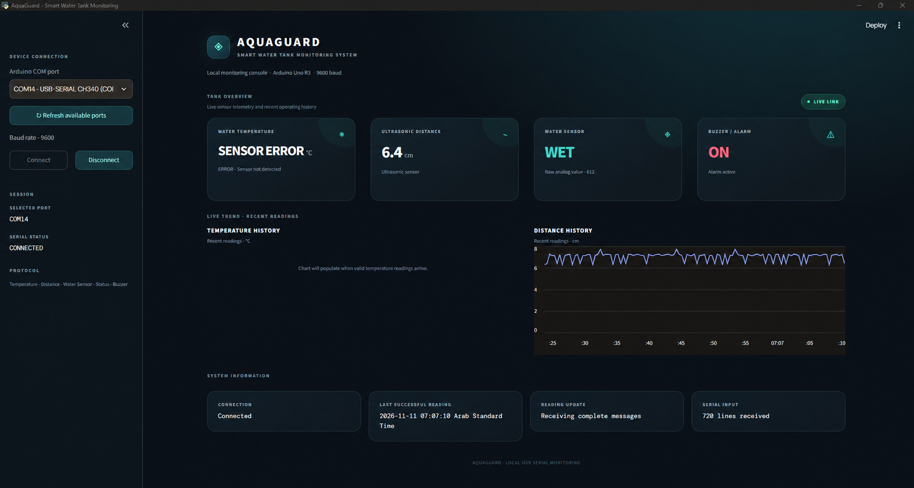
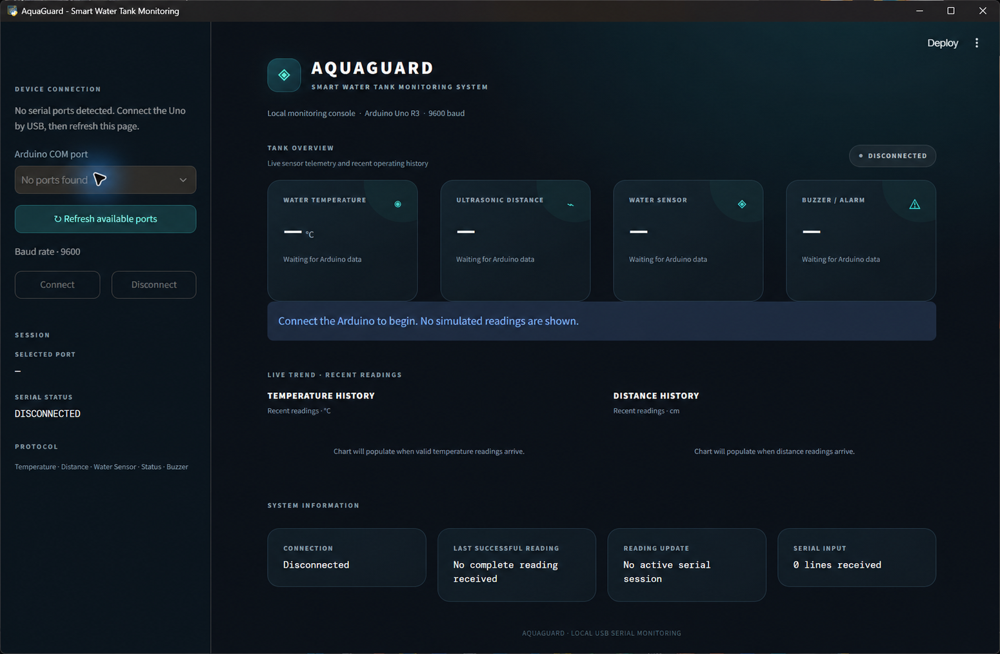

# AquaGuard — Smart Water Tank Monitoring System



AquaGuard is a local Arduino Uno R3 water-tank monitoring prototype. The Uno reads the sensors and sends labeled text over USB serial at 9600 baud. A Python dashboard parses complete messages and displays the measurements in a standalone Windows app window. It does not use Wi-Fi, a cloud backend, or simulated sensor readings.

## Project photos

The hardware photos are the supplied photographs of the actual build. The dashboard images are cleaned screenshots: `dashboard_on.png` reflects the connected screen supplied with the project, and `dashboard_off.png` shows the app waiting while disconnected. A screenshot is a point-in-time record, not a live status indicator.

| Hardware setup — view 1 | Hardware setup — view 2 |
|---|---|
|  |  |

### Dashboard connected



The supplied connected capture reports a live serial link and shows 6.4 cm distance, water status WET (raw value 612), and buzzer ON. It also shows a DS18B20 temperature sensor error, so temperature operation was not validated by that capture.

### Dashboard disconnected



## System architecture

```text
HC-SR04 ─┐
DS18B20 ─┤
Water sensor ─┼─> Arduino Uno R3 ── USB serial (9600 baud) ──> Python serial reader ──> Streamlit UI
OLED ─────┤                                                              │
Buzzer ───┘                                                       Windows WebView2 window
```

The dashboard runs locally. The serial-reading thread assembles complete messages before publishing them to the UI; unexpected lines and incomplete message cycles are ignored. The rolling charts contain only readings received from the connected Arduino.

## Hardware

- Arduino Uno R3
- HC-SR04 ultrasonic distance sensor
- DS18B20 temperature sensor
- Analog water-level sensor
- SSD1306 128×64 OLED display, I²C address `0x3C`
- Buzzer module
- 4.7 kΩ pull-up resistor for the DS18B20 data line

### Pin configuration in the supplied sketch

| Device signal | Uno pin |
|---|---:|
| OLED SDA | A4 (Uno I²C SDA) |
| OLED SCL | A5 (Uno I²C SCL) |
| HC-SR04 TRIG | D9 |
| HC-SR04 ECHO | D10 |
| Water sensor analog output | A0 |
| DS18B20 DATA | D2 |
| Buzzer | D7 |

Connect a 4.7 kΩ pull-up resistor between DS18B20 DATA (D2) and 5V. The sketch uses OneWire and DallasTemperature; resistor presence cannot be verified from firmware alone. Confirm the physical wiring before operation.

The firmware marks water as WET when the analog value is at least 300 and activates the buzzer when a valid distance is 15 cm or less. The buzzer output is configured active-low in the sketch.

## Arduino libraries

Install these libraries through Arduino IDE Library Manager:

- Adafruit GFX Library
- Adafruit SSD1306
- Adafruit BusIO (SSD1306 dependency)
- OneWire
- DallasTemperature

`Wire` is provided with the Arduino AVR board package. The sketch was copied from the existing `AquaGuardSmart_System` Arduino project into `firmware/AquaGuard/AquaGuard.ino` to match this repository's layout; the original file was left untouched. Select **Arduino Uno** and the correct COM port, then upload the repository copy. Close Serial Monitor before connecting the dashboard, because both cannot normally own the same COM port simultaneously.

## Dashboard setup and use (Windows 11)

1. Install Python 3.10 or later.
2. In the `dashboard` folder, create and install the environment:

   ```powershell
   cd dashboard
   py -m venv .venv
   .\.venv\Scripts\python.exe -m pip install -r requirements.txt
   ```

3. Double-click `run_dashboard.bat` from File Explorer. The dashboard opens in a standalone app window using Microsoft Edge WebView2; it does not launch a browser tab.
4. Connect the Uno by USB, close Arduino Serial Monitor, click **Refresh available ports**, select the Arduino COM port, and click **Connect**. The baud rate is 9600.
5. The app shows a waiting/disconnected state until actual complete serial messages arrive. Click **Disconnect** before closing or changing ports.

The dashboard parses `Temperature`, `Distance`, `Water Sensor`, `Status`, and `Buzzer`. It handles temperature error text, `NO ECHO`, incomplete messages, unexpected input, port-open errors, and serial disconnections.

## Serial message format

```text
Temperature: 25.60 Celsius
Distance: 6.14 cm
Water Sensor: 590 | Status: WET
Buzzer: ON
```

This is the firmware's output format, not a claim that the example values are current measurements.

## Verification and limitations

- Dashboard parsing tests: `python -m unittest -v` from the `dashboard` folder; these use test strings and do not emulate hardware.
- Firmware compile: `arduino-cli compile --fqbn arduino:avr:uno firmware/AquaGuard` completed successfully (Uno target).
- The dashboard was checked against the supplied serial format and its actual disconnected waiting state.
- The supplied connected screenshot shows a DS18B20 sensor error. Temperature readings therefore need confirmation on the physical build.
- The sketch was inspected for pin assignments and serial output. Compilation does not verify sensor wiring; no firmware upload or hardware bench test was performed as part of this repository preparation.
- No cloud service or Wi-Fi transport is implemented; this is a local USB-connected prototype.

## License

See [`LICENSE`](LICENSE) for the repository license.
